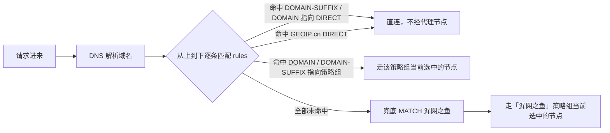

> 用 cc-switch 把 Claude Code 接到第三方中转站（goaichat / kimitk / glmtk 等）时，这些 API 域名在 Clash 里走哪条规则、走什么节点、有没有被代理绕远、怎么修——本文基于真实配置（Clash Verge Rev / verge-mihomo，macOS）逐条检查并给出可照抄的解法。所有 API Key 已脱敏。

<!-- gmeek-meta
{
  "keywords": ["Clash", "cc-switch", "规则匹配", "节点选择", "代理绕远", "DIRECT"],
  "abstract": "第三方 AI 中转站（goaichat / kimitk / glmtk）的 API 域名在国内或香港不设专用节点，直连最快。本文基于 Clash Verge Rev（verge-mihomo）的真实本机配置，先讲清 Clash 规则从上到下顺序匹配的工作模型，再用实测数据展示这些域名当前如何被 GEOIP,cn 与 MATCH 兜底判给「漏网之鱼」策略组；随后给出「什么算被代理绕远」的量化判断标准，覆盖 cc-switch 直连正常、域名变慢、TUN/全局强制代理、节点故障四类场景的解法，重点推荐在 MATCH 之前插入 DOMAIN-SUFFIX 专用 DIRECT 规则并用全局扩展规则防订阅覆盖，最后提供 lsof 出口验证与延迟对比三条验证手段。"
}
-->

## 1. Clash 的工作模型：规则匹配到底怎么走

Clash 处理一个请求（以 `mode: rule` 为例）的流程：



**图 1　Clash 规则匹配流程（mode: rule）**

**关键概念**：

- **规则从上到下顺序匹配，命中即停**——越靠前的规则优先级越高。
- **规则的目标**要么是 `DIRECT`（直连）、要么是 `REJECT`（拦截）、要么是**策略组名**（如 `🚀节点选择`、`🐟漏网之鱼`）。
- **策略组**（proxy-groups）是「可以手动切换的一捆节点」，最终由它**当前选中的节点**决定出口。
- 兜底规则 `MATCH` 抓所有没被前面规则匹配的流量，通常指向 `🐟漏网之鱼`。

---

## 2. 本机配置检查（真实数据）

来自 `~/Library/Application Support/io.github.clash-verge-rev.clash-verge-rev/clash-verge.yaml`（Clash Verge Rev，核心 `verge-mihomo`）。

### 2.1 全局设置

**表 1　全局设置实测值**

| 项 | 值 | 说明 |
|---|---|---|
| `mode` | `rule` | 规则模式（非 global，非 direct） |
| `mixed-port` | `7897` | 混合代理端口 |
| `tun.enable` | `false` | TUN 模式**关闭** |
| `allow-lan` | `false` | 仅本机 |
| `enable_system_proxy` | `true` | 系统代理开启（verge.yaml） |
| `dns.enhanced-mode` | `fake-ip` | 假 IP 模式 |

### 2.2 规则段（关键位置）

**表 2　规则段关键行**

| 行 | 规则 | 作用 |
|---|---|---|
| 2647 | `GEOIP,cn,DIRECT,no-resolve` | 中国 IP 直连（**不 DNS 解析**，靠连接 IP 判断） |
| 10647 | `DOMAIN-SUFFIX,cn,DIRECT` | 所有 `.cn` 域名直连 |
| 10648 | `GEOIP,cn,DIRECT,resolve` | 中国 IP 直连（**先 DNS 解析**再判断） |
| 10649 | `MATCH,🐟漏网之鱼` | **兜底**：所有没命中的 → 漏网之鱼 |

规则总数约 **9263 条**，其中约 **130 条**是 `.cn` 域名直连规则。

### 2.3 是否有这些 API 域名的专用规则

```
grep -inE "goaichat|kimitk|glmtk|43\.161" clash-verge.yaml
→ (空)
```

**没有任何 `goaichat.top` / `kimitk.top` / `glmtk.top` 的专用规则**。这些域名只能靠 `GEOIP` / `MATCH` 兜底。

### 2.4 域名解析到哪（决定 GEOIP 是否兜住）

```
llm.goaichat.top   → 43.161.224.199
ai.goaichat.top    → 43.161.248.32
model.kimitk.top   → 43.161.249.175
ciyuan.glmtk.top   → 43.161.224.199
```

**全部是 43.161.x.x（腾讯云香港，ACEVILLEPTELTD-HK）**——**不是中国 IP**。

### 2.5 关键策略组

**表 3　关键策略组对比**

| 策略组 | type | 含 DIRECT？ | 说明 |
|---|---|---|---|
| `🚀节点选择` | select | ❌ 无 | 主节点选择，**不含 DIRECT** |
| `♻️自动选择` | url-test | ❌ 无 | 自动测速选最快 |
| `🐟漏网之鱼` | select | ✅ **有 DIRECT** | 兜底策略组，**可以手动切直连** |

---

## 3. 核心发现：这些域名当前怎么走

把上面的数据串起来，推导这些 API 域名的实际走向：

```
请求 ai.goaichat.top
  → DNS 解析到 43.161.248.32（香港）
  → 逐条匹配 rules
    → 没有 goaichat 专用规则
    → GEOIP,cn,DIRECT,no-resolve（2647行）：43.161.248.32 不是中国 IP → 不命中
    → DOMAIN-SUFFIX,cn（10647行）：域名不以 .cn 结尾 → 不命中
    → GEOIP,cn,DIRECT,resolve（10648行）：解析后仍不是中国 IP → 不命中
    → MATCH,🐟漏网之鱼（10649行）→ 兜底命中
  → 走「🐟漏网之鱼」策略组当前选中的节点
```

**结论**：

**表 4　核心发现汇总**

| 项 | 值 |
|---|---|
| 这些域名走哪条规则 | **兜底 `MATCH,🐟漏网之鱼`** |
| 走什么节点 | **漏网之鱼当前选中的节点**（默认指向 `🚀节点选择` 的自动节点） |
| 有没有被代理绕远 | **取决于「漏网之鱼」当前选的是代理节点还是 DIRECT** |
| cc-switch 实际转发 | **直连**（实测 `192.168.1.6→43.161.249.175:443`，见 cc-switch 教程） |

> [!NOTE]
> **Clash 规则上**这些域名该走代理（漏网之鱼→节点），但 **cc-switch 不读系统代理**，所以实际是直连。两者结论要分清：
> - **Clash 视角**：规则把它判给代理节点（因为香港 IP 不匹配 `GEOIP,cn`）
> - **cc-switch 视角**：实际直连（cc-switch 是 Rust，不读系统代理）

---

## 4. 判断标准：什么时候算「被代理绕远」

这些 API 是**国内/香港中转站**，直连最快。判断是否被代理「绕远」的标准：

**表 5　被代理绕远的判断标准**

| 观察 | 判断 |
|---|---|
| 域名解析到**中国/香港 IP**（43.161.x.x 等） | 应该直连，走代理=绕远 |
| Clash 规则把它判给 `🐟漏网之鱼`（代理节点） | 规则层面会被代理（但实际是否走取决于 cc-switch） |
| 走 cc-switch 时实测**直连**（`192.168.x.x→43.161.x.x`） | ✅ 正确，没绕远 |
| 走 cc-switch 时实测**连 `127.0.0.1:7897`** | ❌ 被 Clash 代理绕远 |
| `tun.enable=true` 或 `mode: global` | ❌ 所有流量强制走代理（含这些 API） |

---

## 5. 问题场景与解决方案

### 5.1 场景 A：cc-switch 直连正常（本机现状）——什么都不用改 ✅

实测 cc-switch 转发是直连香港，`curl` 直连也快。这是**最优**状态：

- 规则层面这些域名被判给漏网之鱼（代理节点）——**但这无妨**，因为 cc-switch 不读系统代理，实际直连。
- 保持现状即可。

### 5.2 场景 B：这些域名明显变慢 / 超时，怀疑被代理绕远

**验证**（cc-switch 是否真的走了 Clash）：

```bash
# 发起一个请求的同时，抓 cc-switch 的对外连接
CCPID=$(pgrep -f "cc-switch" | head -1)
lsof -nP -p $CCPID -iTCP | grep -v LISTEN
# 看到 127.0.0.1→127.0.0.1:7897 → 走了 Clash（要修）
# 看到 192.168.x.x→43.161.x.x → 直连（不用修）
```

**解法 1（推荐）**：在规则里加一条**专用直连规则**，插在 `MATCH` 之前：

```yaml
rules:
  # 加在 MATCH 兜底之前（越靠前越好）
  - DOMAIN-SUFFIX,goaichat.top,DIRECT
  - DOMAIN-SUFFIX,kimitk.top,DIRECT
  - DOMAIN-SUFFIX,glmtk.top,DIRECT
  - MATCH,🐟漏网之鱼
```

> 这样无论漏网之鱼选什么节点，这些域名都强制直连，不受代理影响。

**解法 2**：把「🐟漏网之鱼」策略组手动切到 **DIRECT**：

```yaml
proxy-groups:
  - name: 🐟漏网之鱼
    type: select
    proxies:
      - DIRECT      # 手动选中这一项
      - 🚀节点选择
      - ...
```

> 但副作用：**所有**漏网流量都直连（包括你要走代理的海外流量），不推荐单独这么干。

**解法 3**：若确实是 TUN/全局导致：

- 关 TUN：`tun.enable: false`
- 或改回 `mode: rule`

### 5.3 场景 C：Clash 开了 TUN 或全局模式，API 被强制代理

```bash
# 检查
grep -E "tun:|enable:" clash-verge.yaml | head
# 若 tun.enable: true 或 mode: global → 所有流量走代理
```

**解决**：

- 首选：**关 TUN**（`tun.enable: false`）——因为 cc-switch 本来就不该走代理，TUN 只对「读系统代理的进程」有影响，但对 cc-switch 这类直连进程，TUN 会**强行劫持**。
- 或：加上述场景 B 的专用 `DIRECT` 规则（TUN 模式下规则仍生效）。

### 5.4 场景 D：某个节点坏了，导致「漏网之鱼」选中的节点连不上

```bash
# 看节点是否正常（mihomo API，需 secret；本机 external-controller 为空）
# 或直接看 Clash Verge 界面 → 节点选择 → 测速
```

**解决**：

- 在 Clash Verge 界面里切换「🚀节点选择」或「🐟漏网之鱼」到另一个正常节点。
- 或改用「♻️自动选择」（url-test 自动测速选最快）。

---

## 6. 操作清单：改规则 / 改节点 / 改模式

### 6.1 加专用规则（推荐，最干净）

Clash Verge → **订阅配置 → 全局扩展规则（Global Extend Rules）**，或直接编辑 `clash-verge.yaml` 的 `rules` 段，在 `MATCH` 之前加：

```yaml
rules:
  - DOMAIN-SUFFIX,goaichat.top,DIRECT
  - DOMAIN-SUFFIX,kimitk.top,DIRECT
  - DOMAIN-SUFFIX,glmtk.top,DIRECT
  - MATCH,🐟漏网之鱼
```

> [!TIP]
> 用**全局扩展规则**的好处：订阅更新时不会被覆盖；直接改 `clash-verge.yaml` 会被下次订阅更新冲掉。

### 6.2 切换节点

Clash Verge 主界面 → **代理（Proxies）** 页 → 找到「🐟漏网之鱼」或「🚀节点选择」→ 点选目标节点 / DIRECT。

### 6.3 改模式 / 关 TUN

- `mode: rule`（推荐，规则模式）
- `tun.enable: false`（关 TUN）

---

## 7. 验证：改完怎么确认生效

**方法一：看规则匹配结果**（mihomo 日志，log-level 至少 info）：

```bash
# 触发一个请求后看日志里该域名的匹配
grep -i "goaichat\|kimitk" ~/Library/Logs/clash-verge/*.log 2>/dev/null | tail
# 期望看到 ... match DIRECT (或对应策略组)
```

**方法二：看实际出口**（最直接）：

```bash
# 发一个请求，同时抓 cc-switch 出口
CCPID=$(pgrep -f "cc-switch" | head -1)
lsof -nP -p $CCPID -iTCP | grep -v LISTEN
# 改后仍看到直连 43.161.x.x = 正确
# 改后看到 127.0.0.1:7897 = 还在走代理（说明 cc-switch 仍不读代理，或规则没生效）
```

**方法三：延迟对比**：

```bash
# 改前 / 改后各测一次，对比 TTFT
python3 api_latency_probe.py --key "sk-***" --base "https://ai.goaichat.top/v1" --model deepseek-v4-flash --rounds 3
```

---

## 8. 常见坑

1. **把「改 Clash 规则」当成解决 cc-switch 慢的万能药** — cc-switch 是 Rust，**默认不读系统代理**，改 Clash 规则对「它是否走代理」几乎没影响。先确认 cc-switch 是否真在走代理（lsof 看出口），再决定要不要改。
2. **`GEOIP,cn,DIRECT` 兜不住香港 IP** — 43.161.x.x 不是中国 IP，不会被 `GEOIP,cn` 匹配。想强制直连必须**加域名规则**（`DOMAIN-SUFFIX,goaichat.top,DIRECT`），靠 IP 规则不可靠。
3. **改 `clash-verge.yaml` 会被订阅覆盖** — 用 Clash Verge 的**全局扩展规则（Global Extend Rules）**功能，或改 profiles 里的规则文件。
4. **TUN 模式会劫持一切** — 即使 cc-switch 不读系统代理，TUN 也会强行抓走流量。TUN 开着时，`DOMAIN-SUFFIX,xxx,DIRECT` 规则是唯一可靠的放行方式。
5. **漏网之鱼默认指向节点，不含 DIRECT 需手动切** — 只有把漏网之鱼切到 DIRECT，兜底流量才直连；节点选择不含 DIRECT，得在漏网之鱼层面切。
6. **改了要重启/重载配置才生效** — Clash Verge 改完规则要「重载配置」或重启；cc-switch 改完要重启 Claude Code。
7. **别用全局模式** — `mode: global` 会让所有流量走代理，这些国内/香港 API 会被强行绕远，慢上加慢。

---

## 9. 结论

把整篇检查串成三句话：

- **现状**：goaichat / kimitk / glmtk 的域名没有专用规则，解析到香港 IP（43.161.x.x），Clash 规则把它们兜底判给「漏网之鱼」；但因为 cc-switch 不读系统代理，实测实际直连——所以**本机目前没被代理绕远，什么都不用改**。
- **什么时候要修**：当 `tun.enable=true`、`mode: global`，或 lsof 看到 cc-switch 出口是 `127.0.0.1:7897` 时，这些域名才真的走了代理。修法首选在 `MATCH` 之前插 `DOMAIN-SUFFIX,xxx.top,DIRECT`，并放到**全局扩展规则**里防订阅更新覆盖。
- **验证闭环**：改完用 mihomo 日志看规则命中、用 lsof 看实际出口、用延迟探测脚本对比改前改后 TTFT，三条通道齐了才算生效。

---

## 附录：本机检查命令速查

```bash
# 配置路径
CFG="$HOME/Library/Application Support/io.github.clash-verge-rev.clash-verge-rev/clash-verge.yaml"

# 1. 全局模式/端口/TUN
grep -E "^(mode|mixed-port|allow-lan|ipv6):|tun:|enable:" "$CFG" | head

# 2. 是否有 API 域名专用规则
grep -inE "goaichat|kimitk|glmtk|43\.161" "$CFG"

# 3. 兜底规则
grep -nE "GEOIP,cn|MATCH" "$CFG"

# 4. 域名解析到哪
for d in llm.goaichat.top ai.goaichat.top model.kimitk.top ciyuan.glmtk.top; do
  echo "$d -> $(dig +short $d | head -1)"
done

# 5. 策略组是否有 DIRECT
grep -nE "漏网之鱼|节点选择" "$CFG" | head

# 6. cc-switch 实际出口（决定性）
CCPID=$(pgrep -f "cc-switch" | head -1)
lsof -nP -p $CCPID -iTCP | grep -v LISTEN
# 192.168.x.x→43.161.x.x = 直连（好）；127.0.0.1:7897 = 走代理（要修）
```

---

## 参考资料

- Clash Verge Rev —— 本机使用的 Clash 图形客户端：https://github.com/clash-verge-rev/clash-verge-rev
- mihomo（原名 Clash Meta）—— Clash Verge Rein 的内核：https://github.com/MetaCubeX/mihomo
- cc-switch —— （内网配套）第三方 API 延迟检测教程见同目录 `教程.md` / `教程.review.md`

---

*基于 2026-10-30 真实检查（Clash Verge Rev / verge-mihomo，macOS）。规则行号、策略组、解析 IP 均为当时实测，订阅更新后可能变化。*