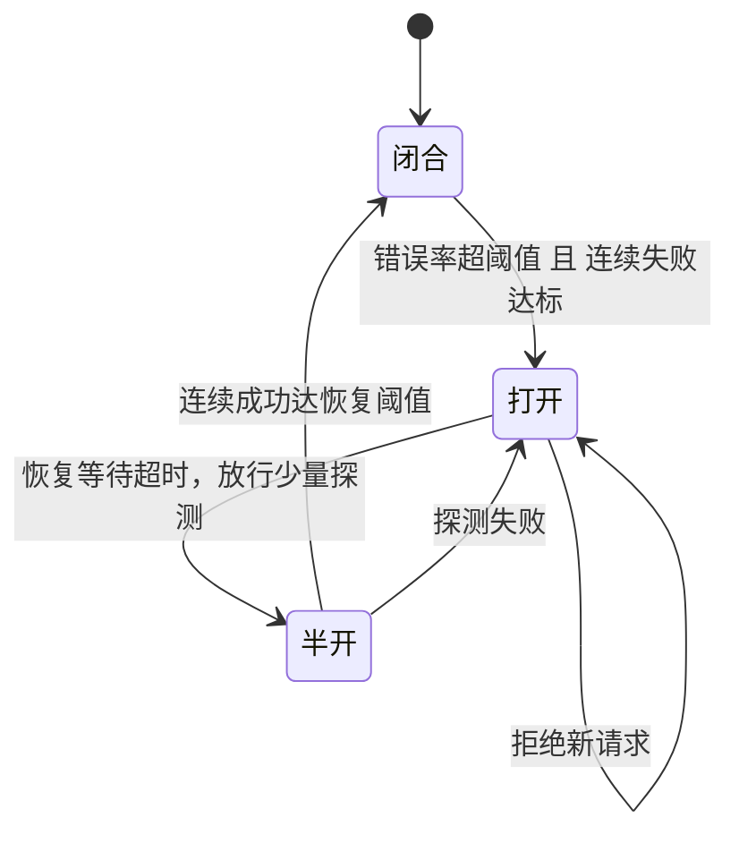
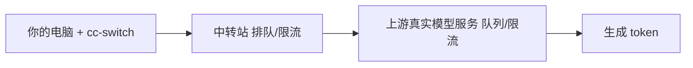

> 用 cc-switch 把 Claude Code 接到第三方中转站之前，先学会科学测延迟（TTFT / 总耗时）、避开并发 429，并把故障转移 / 重试 / 超时 / 熔断器填对。本文给出完整方法、一次 6 端点实测数据，以及可直接照抄的配置值。

<!-- gmeek-meta
{
  "keywords": ["cc-switch", "API 延迟检测", "故障转移", "熔断器"],
  "abstract": "第三方中转站延迟波动的根因在后端排队而非网络，单次测量没有意义。本文面向用 cc-switch 接入 OpenAI 兼容中转站（goaichat / kimitk 系）的用户，先分清 RTT、TTFT、总耗时三个常被混为一谈的概念，给出端点连通性探测与多端点并发比测的方法，并附一个可复用的延迟探测脚本；再用一次 6 端点 × 19 模型的实测说明：连通性判断可以一锤定音，快慢排名必须多次采样取中位。据此给出 cc-switch 故障转移、重试、超时、熔断器各参数的建议值，解释为什么 8 并发必 429、同源端点互切无效的架构真相，最后提供本机三步定位法用于区分是你的问题还是中转站的问题。"
}
-->

## 1. 先搞清三个概念

测「中转站快不快」之前，先分清三个完全不同、经常被混为一谈的数字：

**表 1　三个核心概念**

| 概念 | 是什么 | 受什么影响 | 怎么测 |
|---|---|---|---|
| **网络往返 (RTT)** | TCP+TLS 握手耗时 | 你的宽带、CDN、DNS | 连 `host:443` 握手，取中位数 |
| **首字节 (TTFT)** | 请求发出 → 收到第一个 token | **中转站后端排队**（主导）+ 网络 | 流式请求，记首个 chunk 到达时间 |
| **总耗时** | 请求发出 → 收到 `[DONE]` | TTFT + 生成速度 + token 数 | 同上，全程计时 |

**核心认知：中转站的延迟瓶颈 95% 在「后端排队」，不在网络。**

同一端点同一模型重复测，TTFT 可以从 2.5s 跳到 38s，相差十几倍——这不是端点不稳定，而是后端在按 key / 并发限流、请求在队列里排队。所以：

- **单次测量没有意义**，至少测 3 次取**中位数**；
- **端点之间的网络差距（0.11s vs 0.16s）被后端排队噪声完全淹没**，别用单次结果下「谁快谁慢」的结论。

> [!NOTE]
> 记住一句话：能一锤定音的是「通不通」，不能一锤定音的是「快不快」。全文的探测方法都围绕这两件事展开。

---

## 2. 检测哪些端点 / 怎么拿到模型列表

### 2.1 探测端点连通性（先淘汰连不上的）

```bash
KEY="sk-你的key"
for base in \
  "https://llm.goaichat.top/v1" \
  "https://ai.goaichat.top/v1" \
  "https://ciyuan.glmtk.top/v1" \
  "https://model.kimitk.top/v1" \
  "https://model.goaichat.top/v1" \
  "https://vibe.kimitk.top/v1"; do
  R=$(curl -s -m 5 -o /dev/null -w "%{http_code}|%{time_total}" \
       -H "Authorization: Bearer $KEY" "${base}/models")
  echo "$base -> $R"
done
```

`HTTP 200` = 可用；`timeout / SSL 错误` = 直接淘汰。本例中 `model.goaichat.top` 握手超时、`vibe.kimitk.top` 返回 TLS 内部错误，属于稳定坏，可放心淘汰。

### 2.2 列出该端点有哪些模型

```bash
curl -s -H "Authorization: Bearer $KEY" "https://ai.goaichat.top/v1/models" \
  | python3 -m json.tool
```

返回 `data[].id` 就是可用模型 ID。中转站通常固定一批模型，换端点不换列表（本例 4 个可用端点共用同一套 19 个模型）。

---

## 3. 测延迟：TTFT 和总耗时

### 3.1 一次性脚本（推荐，脚本全文见附录 A）

把附录 A 保存为 `api_latency_probe.py` 后运行：

```bash
python3 api_latency_probe.py \
  --key "sk-你的key" \
  --base "https://ai.goaichat.top/v1" \
  --model "glm-5.3-flash" \
  --rounds 3 \
  --concurrent 1
```

输出示例：

```
  round 1/3 ...
  round 2/3 ...
  round 3/3 ...
=== https://ai.goaichat.top/v1 / glm-5.3-flash  (3/3 成功) ===
TTFT  中位=2.537s  最小=2.1s  最大=4.0s
总耗时 中位=2.6s   最小=2.2s  最大=4.1s
```

`--rounds` 建议 3~5（越多越稳）；`--concurrent` 平时用 1，**不要 >5**（原因见第 5 节）。

### 3.2 多端点并发比测（快速横向对比）

想同时比 4 个端点，用 Python 线程并发，但每个端点内部**串行**测 3 次再取中位：

```python
import urllib.request, json, time, ssl, statistics
from concurrent.futures import ThreadPoolExecutor

KEY = "sk-你的key"
BASES = ["https://llm.goaichat.top/v1", "https://ai.goaichat.top/v1",
         "https://ciyuan.glmtk.top/v1", "https://model.kimitk.top/v1"]
MODEL = "glm-5.3-flash"
ctx = ssl.create_default_context()

def one(base, m, timeout=60):
    t0 = time.time()
    body = json.dumps({"model": m, "messages": [{"role": "user", "content": "说一个字：好"}],
                       "stream": True, "max_tokens": 16}).encode()
    req = urllib.request.Request(f"{base}/chat/completions", data=body,
        headers={"Authorization": f"Bearer {KEY}", "Content-Type": "application/json"})
    ttft = None
    try:
        with urllib.request.urlopen(req, timeout=timeout, context=ctx) as r:
            buf = b""
            while True:
                chunk = r.read(4096)
                if not chunk: break
                if ttft is None: ttft = time.time() - t0  # 首个 chunk 到达 = 首字节时间
                buf += chunk
                if b"[DONE]" in buf: break
        return ttft, time.time() - t0, "OK"
    except Exception as e:
        return ttft, time.time() - t0, str(e)[:40]

def worker(base):
    ttfts, totals = [], []
    for _ in range(3):
        ttft, total, st = one(base, MODEL)
        if st == "OK":
            ttfts.append(ttft); totals.append(total)
        time.sleep(1.5)
    return base, (statistics.median(ttfts), statistics.median(totals))

with ThreadPoolExecutor(max_workers=4) as ex:
    for base, (t1, t2) in ex.map(worker, BASES):
        print(f"{base:40s} TTFT中位={t1:.3f}s  总耗时中位={t2:.3f}s")
```

> [!WARNING]
> **4 个端点并行测、每个端点内部串行**，这是安全姿势。若「端点 × 模型」全并发（如一次 8 个并发），会撞中转站并发墙拿回一堆 429，数据全废。

---

## 4. 实测结论速查表

本例（6 个端点、共用 19 个模型、并发 ≤5、每端点测 3 次取中位，2026-10-30）：

**表 2　端点实测结果**

| 排名 | 端点 | 状态 | 纯网络 RTT | TTFT 中位 | 建议 |
|---|---|---|---|---|---|
| 🥇 | `ai.goaichat.top/v1` | ✅ | 0.111s | **2.5s** | **主用**，网络+推理双快 |
| 🥈 | `model.kimitk.top/v1` | ✅ | 0.153s | 5.7s | 备用 |
| 🥉 | `llm.goaichat.top/v1` | ✅ | 0.131s | 6.6s | 备用（原默认） |
| 4 | `ciyuan.glmtk.top/v1` | ✅ | 0.160s | 13.2s | 排队重，慎用 |
| ❌ | `model.goaichat.top/v1` | 🚫 | 握手超时 | — | 淘汰 |
| ❌ | `vibe.kimitk.top/v1` | 🚫 | TLS 内部错误 | — | 淘汰 |

**模型**：`deepseek-v4-flash` 最快最省流；要强推理用 `glm-5.3-flash` / `kimi-k3`。

> [!IMPORTANT]
> 诚实声明：TTFT 波动大，这张表只代表「测量那一刻」的相对快慢。若接入生产，建议连续观察几天或用多端点负载均衡，别迷信单次排名。

### 4.1 复测对比（同日二次测量）

同一批 6 端点，数小时后复测（流式 TTFT，`deepseek-v4-flash`，单次快测）：

**表 3　两次测量对比**

| 端点 | 第一次 TTFT | 复测 TTFT | 变化 | 说明 |
|---|---|---|---|---|
| `llm.goaichat.top/v1` | 6.6s | **2.47s** | ↑ 变快 | 复测最快 |
| `ai.goaichat.top/v1` | **2.5s** | 5.05s | ↓ 变慢 | 第一次最快，复测退居中游 |
| `ciyuan.glmtk.top/v1` | 13.2s | 5.09s | ↑ 变快 | 波动极大 |
| `model.kimitk.top/v1` | 5.7s | 5.66s | ≈ 持平 | 最稳定 |
| `model.goaichat.top/v1` | 超时 | 超时 | — | 稳定坏 |
| `vibe.kimitk.top/v1` | TLS 错 | TLS 错 | — | 稳定坏 |

复测揭示的关键点：

- **连通性结论完全不变**：4 可用、2 稳定坏（`model.goaichat`、`vibe.kimitk` 两次都连不上，可放心淘汰）。
- **TTFT 排名两次完全不同**（第一次 `ai` 第一、复测 `llm` 第一）——单次排名毫无意义，再次证实瓶颈是后端排队噪声。
- **`model.kimitk.top` 两次都 5.7s 左右**，是相对最稳的节点。

> [!NOTE]
> 判断端点好坏（通 / 不通）是稳定的，可以一锤定音；判断「谁更快」需要多次采样取中位，单次测量会误导。

---

## 5. 并发限制：为什么 8 并发会全 429

**本例中转站的并发硬限制是 5。** 一旦同时发起 >5 个请求，超出的立刻返回：

```
HTTP Error 429: Too Many Requests
```

而且**重试越多越糟**：6 次重试 = 6 个并发请求同时撞墙，后端拒绝速度比重试到达速度还快，等于火上浇油。实测中，8 并发测 4 端点 × 3 模型，几乎全部 429。

**规则**：

- 生产 / 脚本并发 **≤5**，安全起见留 1 余量 → 实际跑 **4**；
- 别把并发开满去「压测」，这中转站不靠吞吐，靠排队；
- 429 出现时**降并发或降速**，不要盲目加 `max_retries`。

---

## 6. cc-switch 里的故障转移 / 重试 / 超时 / 熔断器怎么填

配置存在 `~/.cc-switch/cc-switch.db` 的 `proxy_config` 表（每 app 一行：`claude` / `codex` / `gemini` / `grokbuild`）。claude 路由相关字段当前值与建议值对照：

**表 4　claude 路由参数建议值**

| 参数 | 当前 | **建议** | 为什么 |
|---|---|---|---|
| `auto_failover_enabled` | 0（关） | **1** | 必须先开，否则一切熔断重试都白搭 |
| `max_retries` | 6 | **2** | 并发 5 下 6 重试 = 6 并发撞墙，越重试越糟 |
| `streaming_first_byte_timeout` | 20s | **45s** | 实测 TTFT 峰值 38s，20s 会误杀正常排队 |
| `streaming_idle_timeout` | 30s | **60s** | 长生成留余量 |
| `non_streaming_timeout` | 60s | **120s** | classifier 侧查（~140KB prompt）最易超时 |
| `circuit_failure_threshold` | 8 | **5** | 5 连败 = 一次满并发全灭，该熔断 |
| `circuit_success_threshold` | 2 | **2** | 半开后 2 连胜即恢复 |
| `circuit_timeout_seconds` | 30s | **30s** | 30s 后探测一次，别 <20（探测太勤加重限流） |
| `circuit_error_rate_threshold` | 0.7 | **0.6** | 60% 错误率熔断，比 0.7 敏感但不误伤偶发 429 |
| `circuit_min_requests` | 15 | **10** | = 并发 5 × 2 轮，尽早进入熔断评估 |

> [!WARNING]
> **UI 里 Error Rate 是百分比，不是小数**：数据库存 `0.6`，但设置面板里要填 **60**。填成 `0.6` 会被当成 `0.6%`，等于永不熔断。

---

## 7. 熔断器四参数逐个解释

UI 面板「Circuit Breaker Settings」四个框对应关系：

**表 5　熔断器四参数**

| UI 标签 | 数据库字段 | 建议填 | 一句话解释 |
|---|---|---|---|
| **Recovery Success Threshold** | `circuit_success_threshold` | **2** | 熔断后进入「半开」试探态，连成 2 次就彻底恢复。太大 → 恢复期正常请求被反复拒 |
| **Recovery Wait Time (seconds)** | `circuit_timeout_seconds` | **30** | 熔断后等 30s 才发第一个探测请求。太短探测太勤，反而加重限流 |
| **Error Rate Threshold (%)** | `circuit_error_rate_threshold` | **60** | 错误率超过 60% 就熔断。本网关正常有零星 429，60% 能熔真故障、不误伤偶发限流 |
| **Minimum Requests** | `circuit_min_requests` | **10** | 攒够 10 个请求才算错误率（避免开头 1~2 个失败就误熔断）。= 并发 5 × 2 轮 |

熔断器工作逻辑：统计窗口内错误率超过阈值且请求数达标且连续失败达到阈值 → 熔断打开 → 拒绝所有新请求 → 等恢复等待时间 → 半开放少量探测 → 连续成功达到恢复阈值 → 闭合恢复。

**图 1　熔断器状态机**



---

## 8. 常见坑

1. **单次测量下结论** — TTFT 波动十几倍，至少 3 次取中位，否则结论是噪声。
2. **并发 >5** — 必 429；且 429 时别加 `max_retries`，要**降并发**。
3. **UI 的 Error Rate 填小数** — 填 `60`，不是 `0.6`（填 0.6 = 永不熔断）。
4. **只开熔断器不开总开关** — `auto_failover_enabled` 是总闸，它关着，熔断 / 重试配置都不生效。
5. **`streaming_first_byte_timeout` 太小** — 中转站排队动辄 20~38s，设 20s 会把「慢但正常」的请求当失败重试，重试又叠加并发 → 雪崩。
6. **改完库不重启** — cc-switch 运行中直接改 SQL 会被 UI 覆盖；改完要重启 cc-switch 和 Claude Code 才生效。

---

## 9. 为什么中转站容易出现这些问题

中转站（如 goaichat / kimitk 这类第三方聚合网关）的**核心商业模式**决定了它天然容易出问题——不是它「做得差」，而是架构如此。

### 9.1 它是「二道贩子」，不是服务商

中转站**自己不跑模型**。它拿一个上游 API key（官方 / 大渠道），开个反向代理，把你的请求**转发给上游**，中间赚差价。所以你的延迟 = 你的网络 + 中转站排队 + **上游排队** + 上游生成时间。

**图 2　请求链路**



任何一环排队，都会体现在 TTFT 上。

### 9.2 共享 key = 共享配额，别人挤你

中转站为了省钱，**一个上游 key 服务成百上千用户**。你遇到的大部分 429 / 延迟，不是你的问题，是**别人的流量挤占了共享配额**。所以：

- 同一个中转站，**白天比晚上慢**（高峰期排队）；
- 你测的时候快，下一秒就慢（别人突然涌进来）；
- **换个端点往往没用**——因为多个端点背后是同一个上游 key（见第 11 节，同名同源）。

### 9.3 按并发限流，不是按带宽

中转站限的是**并发请求数**（本例 = 5），不是总流量。因为上游 key 有并发上限，中转站必须卡住。这是为什么：

- **并发 >5 立刻 429**；
- **重试越多越糟**（重试 = 新并发请求 = 继续撞墙）。

### 9.4 中转站自身的脆弱点

**表 6　中转站常见脆弱点**

| 脆弱点 | 表现 | 根因 |
|---|---|---|
| 单点故障 | 整个站全挂 / 超时 | 一个后端进程扛所有用户，没冗余 |
| 上游被拉黑 | 突然大面积 429 / 限流 | 上游检测到 key 异常使用，封了 |
| 额度被刷爆 | 「额度已用尽」 | 共享 key 被人薅羊毛 |
| 恶意刷量 | 你正常用也 429 | 有人用你同一 key 并发轰炸 |
| 节点劣化 | 特定端点握手超时 / TLS 错 | 某个 CDN / 机房节点坏了（本例 `model.goaichat`、`vibe.kimitk` 稳定坏） |

### 9.5 一句话总结

> [!TIP]
> **中转站的问题不是「质量差」，而是「共享」**——共享 key、共享配额、共享并发、单点无冗余。你付的钱买的不是「稳」，是「便宜 + 能用」。所以延迟波动、偶发 429、个别端点挂掉，是**这类服务的常态**，不是配置错误。

### 9.6 怎么判断是你的问题还是中转站的问题

**表 7　问题归属判断**

| 现象 | 更可能是 | 验证方法 |
|---|---|---|
| 偶发 429 | 中转站共享配额 | 降并发重试，若仍偶发 429 就是共享拥挤 |
| 特定端点连不上 | 节点坏了 | 换端点测，通 = 不是你的问题 |
| 所有端点都慢 | 高峰期 / 上游排队 | 错峰再测（深夜），若变快 = 排队 |
| 只有你的 key 429 | 额度用尽 | 查 provider_health / 余额 |
| 网络层慢（curl 直连也慢） | 你的网络 / 代理 | 见第 10 节检查本机 |
| 直连快、走 cc-switch 慢 | cc-switch 转发问题 | 见第 10 节 |

---

## 10. 如何检查本机系统（三步定位法）

怀疑「是本地问题」时，按下面顺序排查，从外到内快速定位。

### 10.1 第一步：绕开一切，直接测上游（排除本地代理干扰）

```bash
# 直连测（不经 cc-switch、不经 Clash），看基础网络是否健康
curl -s -m 10 -o /dev/null -w "HTTP=%{http_code} 连接=%{time_connect}s 首字节=%{time_starttransfer}s 总耗时=%{time_total}s\n" \
  -H "Authorization: Bearer ***" "https://ai.goaichat.top/v1/models"
```

- **能通且快** → 本地链路健康，问题在 cc-switch 或 Claude Code。
- **超时 / 慢** → 你的网络或该端点节点问题，继续 10.2。

### 10.2 第二步：检查系统代理和 Clash 是否劫持了流量

```bash
# 看系统代理（macOS）
networksetup -getwebproxy Wi-Fi      # HTTP 代理
networksetup -getsecurewebproxy Wi-Fi # HTTPS 代理
networksetup -getsocksfirewallproxy Wi-Fi # SOCKS

# 看代理进程是否在跑
ps aux | grep -iE "clash|mihomo|sing-box|v2ray|xray|surge"

# 看域名解析到哪（是否被 CDN 分流）
for d in llm.goaichat.top ai.goaichat.top model.kimitk.top ciyuan.glmtk.top; do
  echo "$d -> $(dig +short $d | head -1)"
done
```

> [!NOTE]
> 关键判断：这些 API 域名解析到**国内 / 香港 IP**（本例 `43.161.x.x` 香港腾讯云）——它们**本来就不该走代理**。如果 Clash 开了「全局代理」或 TUN 模式，这些请求会被强行塞进代理绕一圈，**反而更慢**。正确姿势是让它们走 `DIRECT`（直连）。

### 10.3 第三步：看 cc-switch 转发链路（本地代理层）

```bash
# cc-switch 是否在监听
lsof -nP -iTCP:15721 | grep LISTEN

# Claude Code 实际连的是不是 cc-switch
ps eww <claude_pid> | tr ' ' '\n' | grep ANTHROPIC_BASE_URL
# 期望看到 ANTHROPIC_BASE_URL=http://127.0.0.1:15721/...

# cc-switch 转发时连的是「直连上游」还是「走 Clash」
# 发起一个请求的同时，抓 cc-switch 的对外连接
lsof -nP -p <ccswitch_pid> -iTCP | grep -v LISTEN
# 出现 192.168.x.x → 43.161.x.x = 直连香港（正常）
# 出现 127.0.0.1 → 127.0.0.1:7897 = 走了 Clash（可能被代理绕远）
```

本例实测：cc-switch 进程无 `HTTP_PROXY / HTTPS_PROXY` 环境变量，转发连接是 `192.168.1.6 → 43.161.249.175:443`（直连香港）——**没有走 Clash，这是正确且最优的**。若发现它走了 Clash，反而是问题。

### 10.4 本机检查结论速查

**表 8　本机检查项**

| 检查项 | 正常值 | 异常时 |
|---|---|---|
| `curl` 直连上游 | 通、快 | 网络 / 节点问题 |
| 系统代理 | 可开可关 | 全局 / TUN 模式会绕远 |
| 域名解析 | 国内 / 香港 IP | 解析到海外 = 可能被劫持 |
| cc-switch 监听 | `127.0.0.1:15721` | 没监听 = Claude 直连官方 |
| Claude 连 cc-switch | `BASE_URL=http://127.0.0.1:15721` | 连官方 = cc-switch 没接管 |
| cc-switch 转发 | 直连 `43.161.x.x` | 走 `7897` = 被代理绕远 |

---

## 11. 故障转移的架构真相（同源端点互切没用）

**⚠️ 最重要的一条，容易被忽略：**

本例里 `ai.goaichat / llm.goaichat / model.kimitk / ciyuan.glmtk` 四个端点，**是同一套后端**——同一个 key、同一批 19 个模型、同源返回、共用同一并发 / 额度限制。

所以端点之间做故障转移，**防不住「后端整体挂 / 整体限流」**：一个端点 429，其他三个大概率同时 429。端点级故障转移只能防「某个域名 / CDN 单点网络故障」，防不了配额和全局限流。

**真正有效的备援是「独立后端」**，例如：

- **DeepSeek 官方** `https://api.deepseek.com/anthropic`（Anthropic 原生格式，cc-switch 可直接路由，官方文档见参考资料）
- 或另一个完全无关的中转站（不同注册商、不同额度池）

**建议配置**：

1. 主：`ai.goaichat.top/v1`（实测最快）作主 provider；
2. 备：DeepSeek 官方（独立后端）加进故障转移队列；
3. 想要端点级备援，可再复制一个 provider 指向 `model.kimitk.top/v1` 入队——但要知道它防不住后端整体故障。

> [!WARNING]
> 检查方式：`sqlite3 ~/.cc-switch/cc-switch.db "SELECT id,name,is_current,in_failover_queue FROM providers WHERE app_type='claude';"`
> 若所有 `in_failover_queue=0`，说明队列是空的，开了故障转移也没目标可切。

---

## 12. 结论

1. **延迟瓶颈在排队不在网络**：TTFT 波动十几倍是后端排队噪声，网络差异（0.11s vs 0.16s）会被完全淹没；判断「通不通」可一锤定音，「快不快」必须多次采样取中位。
2. **避开并发墙**：中转站并发硬限制 5，并发 >5 必 429；429 时降并发降速，别加 `max_retries`。
3. **配置按表抄**：`auto_failover_enabled=1` 是总闸；`max_retries=2`；首字节约 45s；熔断器错误率阈值面板上填 60（不是 0.6）等，全套建议值见表 4、表 5。
4. **故障转移要切「独立后端」**：同源端点互切防不住整体故障，真正可靠的是 DeepSeek 官方这类独立后端入队。
5. **先自检再甩锅**：怀疑慢时按第 10 节三步定位，先确认你的链路没走代理绕远，再谈中转站的问题。

---

## 附录 A：api_latency_probe.py（单端点延迟探测脚本）

保存为 `api_latency_probe.py`，用法见第 3.1 节。逻辑：对指定端点多轮发起流式 chat 请求，记录每个请求的 TTFT（首个 chunk 到达时间）与总耗时（到 `[DONE]`），最终输出成功轮次的中位 / 最小 / 最大；`--concurrent >1` 时用线程池并发发请求（出于第 5 节的限流原因，生产不建议超过 5）。

```python
#!/usr/bin/env python3
"""
中转站 API 延迟检测脚本（流式 TTFT + 总耗时 + 并发/串行模式）
用法:
  python3 api_latency_probe.py --key sk-xxx --base https://ai.goaichat.top/v1 --model glm-5.3-flash [--rounds 3] [--concurrent 1]

指标说明:
  TTFT   = 首字节到达时间（排队+网络往返，不含生成），越小越好
  total  = 请求发出到 [DONE] 全耗时
  注意: TTFT 波动大（后端排队），单次不可靠，取中位数；并发 >5 会触发 429（中转站硬限制）
"""
import argparse, json, time, ssl, urllib.request, statistics
from concurrent.futures import ThreadPoolExecutor

def one_request(base, model, key, timeout=60):
    t0 = time.time()
    body = json.dumps({"model": model,
        "messages": [{"role": "user", "content": "说一个字：好"}],
        "stream": True, "max_tokens": 16}).encode()
    req = urllib.request.Request(f"{base}/chat/completions", data=body,
        headers={"Authorization": f"Bearer {key}", "Content-Type": "application/json"})
    ttft = None
    try:
        with urllib.request.urlopen(req, timeout=timeout, context=ssl.create_default_context()) as r:
            first = time.time(); buf = b""
            while True:
                chunk = r.read(4096)
                if not chunk: break
                if ttft is None: ttft = time.time() - t0
                buf += chunk
                if b"[DONE]" in buf: break
        return ttft, time.time() - t0, "OK"
    except Exception as e:
        return ttft, time.time() - t0, str(e)[:40]

def main():
    ap = argparse.ArgumentParser()
    ap.add_argument("--key", required=True)
    ap.add_argument("--base", required=True, help="如 https://ai.goaichat.top/v1")
    ap.add_argument("--model", required=True)
    ap.add_argument("--rounds", type=int, default=3)
    ap.add_argument("--concurrent", type=int, default=1, help="并发数, 中转站通常限制5, 别超")
    a = ap.parse_args()

    if a.concurrent > 1:
        print(f"[!] 并发 {a.concurrent}: 中转站并发限制通常为5, 超出会 429")
        with ThreadPoolExecutor(max_workers=a.concurrent) as ex:
            futs = [ex.submit(one_request, a.base, a.model, a.key) for _ in range(a.rounds)]
            res = [f.result() for f in futs]
    else:
        res = []
        for i in range(a.rounds):
            print(f"  round {i+1}/{a.rounds} ...")
            res.append(one_request(a.base, a.model, a.key))
            time.sleep(1.5)

    ok = [r for r in res if r[2] == "OK"]
    print(f"\n=== {a.base} / {a.model}  ({len(ok)}/{a.rounds} 成功) ===")
    if ok:
        ttfts = [r[0] for r in ok]; totals = [r[1] for r in ok]
        print(f"TTFT  中位={statistics.median(ttfts):.3f}s  最小={min(ttfts):.3f}s  最大={max(ttfts):.3f}s")
        print(f"总耗时 中位={statistics.median(totals):.3f}s  最小={min(totals):.3f}s  最大={max(totals):.3f}s")
    for r in res:
        if r[2] != "OK":
            print(f"  失败: {r[2]}")

if __name__ == "__main__":
    main()
```

---

## 参考资料

- DeepSeek 官方 Anthropic 兼容 API 文档：https://api-docs.deepseek.com/guides/anthropic_api （`https://api.deepseek.com/anthropic`，cc-switch 可直接路由为独立后端）
- OpenAI Streaming Chat Completions 文档：https://platform.openai.com/docs/api-reference/chat/create （流式 `[DONE]` 标记与 token 分块语义）
- HTTP 429 Too Many Requests（RFC 6585 §4）：https://datatracker.ietf.org/doc/html/rfc6585
- Gmeek —— 本博客的引擎：https://github.com/Meekdai/Gmeek

---

*本文基于 2026-10-30 两次真实检测（首测 + 数小时后复测，6 端点 × 19 模型）整理，所有 Key 已脱敏。连通性结论（4 可用 / 2 稳定坏）两次一致；TTFT 数值为当时测量结果，会随后端负载剧烈变化，请以复测为准。*
