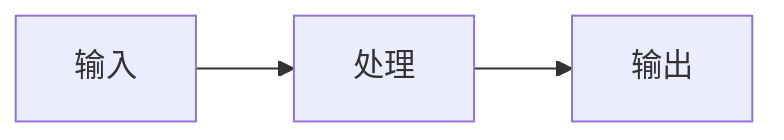

# 文章标题

> 用一句话说明本文解决什么问题，以及读者看完能得到什么。

<!-- gmeek-meta
{
  "keywords": ["关键词一", "关键词二", "关键词三"],
  "abstract": "本文介绍……（可选，不写则自动取正文首段）",
  "receivedDate": "2026-10-28",
  "fund": "",
  "authorBio": "",
  "correspondingAuthor": ""
}
-->

## 一、问题背景

说明问题是什么、为什么值得解决。

### 1. 现状分析

正文段落。一个段落只表达一个中心观点。

> [!NOTE]
> 这里放对读者有帮助的背景提醒。

### 2. 核心问题

- 问题一
- 问题二
- 问题三

## 二、核心方法

### 1. 方法概览

解释整体方案。



**图 1　整体处理流程**

### 2. 关键实现

```typescript
export function solve(input: Input): Output {
  return transform(input);
}
```

代码块下方解释关键作用与边界条件。

### 3. 参数对比

**表 1　参数说明**

| 参数 | 含义 | 示例 |
| --- | --- | --- |
| `input` | 输入数据 | `data.json` |
| `output` | 输出结果 | `result.html` |

## 三、工程实践

### 1. 正常流程

1. 第一步
2. 第二步
3. 第三步

### 2. 异常情况

> [!WARNING]
> 这里说明容易出错的地方和处理方式。

```bash
npm run test
npm run build
```

## 四、方案对比

| 方案 | 优点 | 缺点 | 适用场景 |
| --- | --- | --- | --- |
| 方案 A | 实现简单 | 扩展性一般 | 小型项目 |
| 方案 B | 灵活 | 成本较高 | 中大型项目 |

## 五、结论

总结核心结论，并给出下一步建议。

---

## 参考资料

- [资料名称](https://example.com)
- [资料名称](https://example.com)

<!-- 写作约定
1. 文章标题用 Issue 标题，正文不要再写同一个 # 标题。
2. 章节用 ##，小节用 ###，更深用 ####；不要跳级。
3. 代码块必须标注语言；Mermaid 用 ```mermaid。
4. 图题、表题用粗体单独一行写在图/表上方或下方。
5. 不要用 <br>、&nbsp;、空行或 HTML 控制分页——分页由引擎负责。
6. 普通引用用于引文；需要醒目提示用 GitHub Alert（[!NOTE] 等）。
7. 关键词写进 gmeek-meta；不写则回退到全局配置或 Issue 标签。
-->
