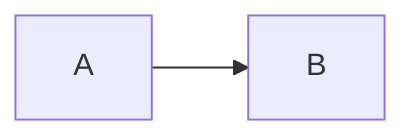

# GitHub Markdown Journal Adaptation Implementation Plan

> **For agentic workers:** REQUIRED SUB-SKILL: Use superpowers:subagent-driven-development (recommended) or superpowers:executing-plans to implement this plan task-by-task. Steps use checkbox (`- [ ]`) syntax for tracking.

**Goal:** Make GitHub Issue Markdown render as a stable technical-magazine article with metadata fallbacks, GFM-compatible Callouts/Mermaid handling, semantic Markdown typography, and reliable paper pagination.

**Architecture:** Parse and remove `gmeek-meta` from raw Issue Markdown before GitHub rendering, preserve the existing trailing `##{...}` build configuration, merge article metadata into a dedicated `journalMeta` object, and pass it to `post.html`. Keep Markdown-to-HTML conversion in `Gmeek.py`, visual rules in `journal-style.css`, Mermaid/Callout normalization in a small browser adapter, and page splitting in `journal-paginate.js`.

**Tech Stack:** Python 3.8, Jinja2, GitHub Markdown REST API in GFM mode, vanilla JavaScript, CSS, pytest.

## Global Constraints

- Use GitHub Flavored Markdown (`mode: "gfm"`) and pass `context: owner/repository` to the Markdown API.
- `gmeek-meta` is strict JSON; malformed metadata is ignored without failing the article build.
- Existing trailing `##{...}` configuration remains supported for `timestamp`, `style`, `script`, `head`, and `ogImage`.
- Empty author, affiliation, fund, author bio, corresponding author, abstract, and keyword values render no empty row.
- Do not fabricate DOI, volume, issue identity, fund numbers, or dates.
- Markdown authors must not write HTML/CSS to control pagination; pagination is owned by `journal-paginate.js`.
- Preserve mobile single-column natural scrolling at viewport widths `<= 720px`.
- Run tests before every implementation commit; use Chinese comments/docstrings for non-obvious constraints.

## File Map

- Modify: `Gmeek.py` — extract metadata, pass GFM repository context, merge journal fallbacks, and pass `journalMeta` to the post template.
- Modify: `templates/post.html` — consume `journalMeta`, render conditional metadata/footer fields, and load the browser Markdown adapter.
- Modify: `static/assets/journal-style.css` — style Markdown semantic elements, alerts, Mermaid containers, metadata rows, and paper pages.
- Create: `static/assets/journal-markdown.js` — normalize Mermaid fenced blocks and GitHub Alert fallbacks without destroying original content on failure.
- Modify: `static/assets/journal-paginate.js` — protect normalized block elements (`pre`, `table`, `figure`, alerts, Mermaid) from page splitting.
- Modify: `tests/test_journal_layout_contract.py` — add CSS/template contracts for metadata and GFM elements.
- Create: `tests/test_journal_metadata.py` — unit tests for raw metadata extraction, malformed metadata, and field precedence.
- Create: `tests/test_markdown_adapter_contract.py` — static contracts for adapter loading and fallback behavior.
- Create: `docs/article-template.md` — copyable GitHub Issue article template.
- Modify: `config.json` in the Earth repository — add global journal defaults and ignored labels after implementation is validated.
- Synchronize: Earth `static/assets/journal-style.css`, `journal-markdown.js`, and `journal-paginate.js` from Emeek before deployment.

---

### Task 1: Add failing metadata extraction tests

**Files:**
- Create: `tests/test_journal_metadata.py`

**Interfaces:**
- Produces tests for `extract_journal_meta(markdown: str) -> tuple[dict, str]`.
- Produces tests for `merge_journal_meta(article: dict, config: dict, issue: dict) -> dict`.

- [ ] **Step 1: Write the failing tests**

```python
from Gmeek import extract_journal_meta, merge_journal_meta


def test_extracts_and_removes_strict_gmeek_meta_block():
    source = """# Title

<!-- gmeek-meta
{"author":"郑郑","keywords":["GFM","期刊"]}
-->

正文段落。
"""
    meta, body = extract_journal_meta(source)
    assert meta == {"author": "郑郑", "keywords": ["GFM", "期刊"]}
    assert "gmeek-meta" not in body
    assert "正文段落" in body


def test_malformed_meta_is_ignored_without_losing_body():
    source = """<!-- gmeek-meta
{"author":
-->
正文。
"""
    meta, body = extract_journal_meta(source)
    assert meta == {}
    assert "正文" in body


def test_article_metadata_precedes_config_and_issue_fallbacks():
    merged = merge_journal_meta(
        {"author": "单篇作者", "keywords": ["单篇关键词"]},
        {"journalAuthor": "全局作者", "journalKeywords": ["全局关键词"]},
        {"author": "Issue 作者", "labels": ["标签关键词"]},
    )
    assert merged["author"] == "单篇作者"
    assert merged["keywords"] == ["单篇关键词"]


def test_missing_metadata_uses_config_then_issue_and_hides_empty_fields():
    merged = merge_journal_meta(
        {},
        {"journalAuthor": "全局作者", "journalAffiliation": "单位", "journalFund": ""},
        {"author": "Issue 作者", "labels": ["draft", "技术"]},
    )
    assert merged["author"] == "全局作者"
    assert merged["affiliation"] == "单位"
    assert merged["fund"] is None
    assert merged["keywords"] == ["技术"]
```

- [ ] **Step 2: Run the tests to verify the expected failure**

Run:

```bash
cd /Users/jason/Documents/Blog/Emeek
python3 -m pytest tests/test_journal_metadata.py -q
```

Expected: FAIL because `extract_journal_meta` and `merge_journal_meta` do not exist yet.

- [ ] **Step 3: Commit the failing tests**

```bash
git add tests/test_journal_metadata.py
git commit -m "test(metadata): define journal metadata precedence"
```

---

### Task 2: Implement metadata parsing and GFM context

**Files:**
- Modify: `Gmeek.py:128-145` for Markdown API payload.
- Modify: `Gmeek.py:315-403` for Issue body parsing and metadata merge.
- Test: `tests/test_journal_metadata.py`.

**Interfaces:**
- `extract_journal_meta(markdown: str) -> tuple[dict, str]` returns parsed metadata and Markdown with the block removed.
- `merge_journal_meta(article_meta: dict, config: dict, issue: dict) -> dict` returns keys `author`, `affiliation`, `abstract`, `keywords`, `receivedDate`, `fund`, `authorBio`, `correspondingAuthor`.
- `markdown2html(self, mdstr)` sends `{"text": mdstr, "mode": "gfm", "context": self.options.repo_name}`.
- `createPostHtml` passes `journalMeta=merge_journal_meta(...)` into the post template.
- Because `Gmeek.py` currently executes CLI work at import time, move parser/runner code under `if __name__ == "__main__":` before importing helpers in tests; preserve the existing CLI arguments and runtime branch behavior.

- [ ] **Step 1: Implement strict extraction before API rendering**

Add helpers near the module-level constants:

```python
GMEek_META_RE = re.compile(
    r"<!--\s*gmeek-meta\s*(\{.*?\})\s*-->", re.DOTALL
)


def extract_journal_meta(markdown):
    """提取单篇期刊元信息，并从正文中移除元数据块。"""
    match = GMEek_META_RE.search(markdown or "")
    if not match:
        return {}, markdown or ""
    try:
        value = json.loads(match.group(1))
    except (TypeError, json.JSONDecodeError):
        return {}, markdown or ""
    if not isinstance(value, dict):
        return {}, markdown or ""
    return value, markdown[:match.start()] + markdown[match.end():]
```

Add the GFM context:

```python
payload = {
    "text": mdstr,
    "mode": "gfm",
    "context": self.options.repo_name,
}
```

- [ ] **Step 2: Implement deterministic merge and label filtering**

Add helpers:

```python
def _clean_text(value):
    if value is None:
        return None
    value = str(value).strip()
    return value or None


def merge_journal_meta(article_meta, config, issue):
    """合并单篇配置、全局配置和 Issue 兜底字段。"""
    ignored = set(config.get("journalIgnoredLabels", []))
    labels = [label for label in issue.get("labels", []) if label not in ignored]
    author = (
        _clean_text(article_meta.get("author"))
        or _clean_text(config.get("journalAuthor"))
        or _clean_text(issue.get("author"))
        or _clean_text(config.get("title"))
    )
    affiliation = (
        _clean_text(article_meta.get("affiliation"))
        or _clean_text(config.get("journalAffiliation"))
    )
    keywords = article_meta.get("keywords") or config.get("journalKeywords") or labels
    keywords = [str(item).strip() for item in keywords if str(item).strip()]
    return {
        "author": author,
        "affiliation": affiliation,
        "abstract": _clean_text(article_meta.get("abstract")) or _clean_text(issue.get("description")) or _clean_text(config.get("journalDefaultAbstract")),
        "keywords": keywords,
        "receivedDate": _clean_text(article_meta.get("receivedDate")) or _clean_text(issue.get("createdDate")),
        "fund": _clean_text(article_meta.get("fund")) or _clean_text(config.get("journalFund")),
        "authorBio": _clean_text(article_meta.get("authorBio")) or _clean_text(config.get("journalAuthorBio")),
        "correspondingAuthor": _clean_text(article_meta.get("correspondingAuthor")) or _clean_text(config.get("journalCorrespondingAuthor")),
    }
```

In `createPostHtml`, read the Issue Markdown, extract metadata before `markdown2html`, and assign `postBase["journalMeta"] = merge_journal_meta(...)`. Preserve the existing trailing `##{...}` parsing for build controls.

- [ ] **Step 3: Run tests to verify they pass**

Run:

```bash
python3 -m pytest tests/test_journal_metadata.py -q
```

Expected: all metadata tests PASS.

- [ ] **Step 4: Run the existing suite**

Run:

```bash
python3 -m pytest tests/ -q
```

Expected: all existing tests plus metadata tests PASS.

- [ ] **Step 5: Commit**

```bash
git add Gmeek.py tests/test_journal_metadata.py
git commit -m "feat(metadata): parse journal meta and GFM context"
```

---

### Task 3: Adapt the post template to `journalMeta`

**Files:**
- Modify: `templates/post.html:77-106`.
- Modify: `tests/test_journal_layout_contract.py`.
- Test: `tests/test_journal_metadata.py`.

**Interfaces:**
- Template consumes `journalMeta` with the exact keys from Task 2.
- `postLabels` remains available as a compatibility variable but is derived from `journalMeta["keywords"]` for the journal view.

- [ ] **Step 1: Add failing template contract tests**

```python
def test_template_uses_journal_meta_and_hides_optional_footer_rows():
    assert "journalMeta" in POST
    assert "journalMeta['author']" in POST or 'journalMeta["author"]' in POST
    assert "journalMeta['fund']" in POST or 'journalMeta["fund"]' in POST
    assert "journalMeta['authorBio']" in POST or 'journalMeta["authorBio"]' in POST
    assert "journalMeta['correspondingAuthor']" in POST or 'journalMeta["correspondingAuthor"]' in POST
```

- [ ] **Step 2: Run the focused test to verify it fails**

Run:

```bash
python3 -m pytest tests/test_journal_layout_contract.py::test_template_uses_journal_meta_and_hides_optional_footer_rows -q
```

Expected: FAIL because the current template reads `blogBase` fields directly and has no optional article footer rows.

- [ ] **Step 3: Implement the template change**

Replace direct author/affiliation/abstract/date reads with guarded `journalMeta` access:

```jinja2

<div class="journal-authors">{{ meta['author'] }}</div>
<div class="journal-affil">{{ meta['affiliation'] }}</div>

<div class="journal-abstract">
  <span class="jlabel">摘&nbsp;&nbsp;要：</span><span class="jtext">{{ meta['abstract'] }}</span>
</div>


<div class="journal-keywords">
  <span class="jlabel">关键词：</span>
  <span class="jkw-list"><a class="jkeyword" href="{{ blogBase['homeUrl'] }}/tag.html#{{ label|urlencode }}">{{ label }}</a>；</span>
</div>

```

Render the article footer after `.journal-paper`, before site footer:

```jinja2

<footer class="journal-meta-foot">
  <div>收稿日期：{{ meta['receivedDate'] }}</div>
  <div>基金项目：{{ meta['fund'] }}</div>
  <div>作者简介：{{ meta['authorBio'] }}</div>
  <div>通信作者：{{ meta['correspondingAuthor'] }}</div>
</footer>

```

- [ ] **Step 4: Run all tests**

Run:

```bash
python3 -m pytest tests/ -q
```

Expected: all tests PASS.

- [ ] **Step 5: Commit**

```bash
git add templates/post.html tests/test_journal_layout_contract.py
 git commit -m "feat(template): render journal metadata and optional footer"
```

---

### Task 4: Add Markdown adapter for Callouts and Mermaid

**Files:**
- Create: `static/assets/journal-markdown.js`.
- Modify: `templates/post.html` to load it after the body exists.
- Create: `tests/test_markdown_adapter_contract.py`.

**Interfaces:**
- Browser global: `window.JournalMarkdownAdapter.init(root) -> void`.
- It transforms only `pre > code.language-mermaid` and normalizes known GitHub Alert/legacy quote shapes.
- On Mermaid failure or unknown block, it leaves the original `<pre>` visible.
- Mermaid rendering uses an explicit versioned CDN script loaded by the template before the adapter; if the CDN is unavailable, the adapter leaves readable Mermaid source code.

- [ ] **Step 1: Write failing static contract tests**

```python
from pathlib import Path

ROOT = Path(__file__).parents[1]
ADAPTER = (ROOT / "static/assets/journal-markdown.js").read_text(encoding="utf-8") if (ROOT / "static/assets/journal-markdown.js").exists() else ""
POST = (ROOT / "templates/post.html").read_text(encoding="utf-8")


def test_markdown_adapter_file_and_public_api_exist():
    assert "JournalMarkdownAdapter" in ADAPTER
    assert "init" in ADAPTER
    assert "language-mermaid" in ADAPTER


def test_post_loads_markdown_adapter_after_template_scripts():
    assert "journal-markdown.js" in POST
```

- [ ] **Step 2: Run the focused test to verify it fails**

Run:

```bash
python3 -m pytest tests/test_markdown_adapter_contract.py -q
```

Expected: FAIL because the adapter does not exist.

- [ ] **Step 3: Implement the adapter**

Create a no-dependency adapter:

```javascript
(function (window, document) {
  'use strict';

  function findMermaidBlocks(root) {
    return Array.prototype.slice.call(
      root.querySelectorAll('pre > code.language-mermaid, pre > code.lang-mermaid')
    );
  }

  function renderMermaid(code) {
    var wrapper = document.createElement('div');
    wrapper.className = 'mermaid';
    wrapper.textContent = code.textContent;
    return wrapper;
  }

  function adaptMermaid(root) {
    findMermaidBlocks(root).forEach(function (code) {
      var pre = code.parentElement;
      if (!pre || !pre.parentElement) return;
      var wrapper = renderMermaid(code);
      pre.parentElement.replaceChild(wrapper, pre);
    });
  }

  function markLegacyAlert(blockquote) {
    var title = blockquote.querySelector('p:first-child');
    if (!title) return;
    var text = title.textContent.trim().toUpperCase();
    var match = text.match(/^\[!(NOTE|TIP|IMPORTANT|WARNING|CAUTION)\]$/);
    if (!match) return;
    blockquote.classList.add('markdown-alert', 'markdown-alert-' + match[1].toLowerCase());
    title.classList.add('markdown-alert-title');
    title.textContent = match[1];
  }

  function init(root) {
    var scope = root || document;
    scope.querySelectorAll('blockquote').forEach(markLegacyAlert);
    adaptMermaid(scope);
    if (window.mermaid && typeof window.mermaid.run === 'function') {
      window.mermaid.run({ nodes: scope.querySelectorAll('.mermaid') });
    }
  }

  window.JournalMarkdownAdapter = { init: init };
})(window, document);
```

Call it after the post body exists:

```javascript
if (window.JournalMarkdownAdapter) {
  window.JournalMarkdownAdapter.init(document.getElementById('postBody'));
}
```

The template must load a pinned Mermaid CDN version before `journal-markdown.js` (for example, `https://cdn.jsdelivr.net/npm/mermaid@11.12.2/dist/mermaid.min.js`). The adapter must not remove a source `<pre>` until Mermaid is available and rendering succeeds; otherwise the original code block remains visible.

- [ ] **Step 4: Run tests**

Run:

```bash
python3 -m pytest tests/test_markdown_adapter_contract.py tests/ -q
```

Expected: all tests PASS.

- [ ] **Step 5: Commit**

```bash
git add static/assets/journal-markdown.js templates/post.html tests/test_markdown_adapter_contract.py
git commit -m "feat(markdown): adapt Mermaid and GitHub alert blocks"
```

---

### Task 5: Style semantic Markdown and metadata footer

**Files:**
- Modify: `static/assets/journal-style.css`.
- Modify: `tests/test_journal_layout_contract.py`.

**Interfaces:**
- CSS selectors target the HTML emitted by GitHub GFM and Task 4.
- `.journal-meta-foot` renders only non-empty metadata rows.

- [ ] **Step 1: Add failing CSS contracts**

```python
def test_markdown_adapter_elements_are_cross_column_and_page_safe():
    assert ".jpage.markdown-body .markdown-alert" in STYLE
    assert ".jpage.markdown-body .mermaid" in STYLE
    assert "break-inside:avoid" in STYLE.replace(" ", "")


def test_optional_journal_footer_has_small_print_style():
    assert ".journal-meta-foot" in STYLE
    rule = css_rule(".journal-meta-foot")
    assert "font-size" in rule
    assert "border-top" in rule
```

- [ ] **Step 2: Run tests to verify they fail**

Run:

```bash
python3 -m pytest tests/test_journal_layout_contract.py::test_markdown_adapter_elements_are_cross_column_and_page_safe tests/test_journal_layout_contract.py::test_optional_journal_footer_has_small_print_style -q
```

Expected: FAIL because the selectors do not exist yet.

- [ ] **Step 3: Add semantic Markdown styles**

Add styles after the existing blockquote/list rules:

```css
.jpage.markdown-body .markdown-alert,
.jpage.markdown-body blockquote.markdown-alert,
.jpage.markdown-body .mermaid,
.jpage.markdown-body table,
.jpage.markdown-body figure {
  column-span: all;
  break-inside: avoid;
}

.jpage.markdown-body .markdown-alert {
  margin: 0.8em 0;
  padding: 0.65em 1em;
  border-left: 3px solid var(--journal-border);
  background: rgba(118, 111, 101, 0.08);
}

.jpage.markdown-body .markdown-alert-title {
  margin: 0 0 0.35em;
  font-family: var(--journal-hei);
  font-weight: 700;
  font-size: var(--journal-small-size);
}

.jpage.markdown-body .markdown-alert-warning,
.jpage.markdown-body .markdown-alert-caution {
  border-left-color: var(--journal-accent);
}

.jpage.markdown-body .mermaid {
  margin: 0.9em 0;
  padding: 0.75em;
  overflow-x: auto;
  text-align: center;
  background: rgba(118, 111, 101, 0.04);
}

.journal-meta-foot {
  margin-top: 24px;
  padding-top: 12px;
  border-top: 1px solid var(--journal-border);
  font-family: var(--journal-hei);
  font-size: var(--journal-small-size);
  line-height: 1.9;
}
```

- [ ] **Step 4: Run all tests**

Run:

```bash
python3 -m pytest tests/ -q
```

Expected: all tests PASS.

- [ ] **Step 5: Commit**

```bash
git add static/assets/journal-style.css tests/test_journal_layout_contract.py
git commit -m "feat(style): adapt GFM blocks to journal typography"
```

---

### Task 6: Protect semantic blocks during pagination and add article template

**Files:**
- Modify: `static/assets/journal-paginate.js`.
- Create: `docs/article-template.md`.
- Test: `tests/test_journal_paginate.py`.

**Interfaces:**
- Pagination treats `pre`, `table`, `figure`, `.markdown-alert`, and `.mermaid` as indivisible blocks.
- `docs/article-template.md` is the copyable user-facing template from the approved spec.

- [ ] **Step 1: Add failing pagination contracts**

```python
def test_pagination_source_names_semantic_blocks_as_page_safe():
    source = PAGINATE_TEXT
    for selector in ["PRE", "TABLE", "FIGURE", "markdown-alert", "mermaid"]:
        assert selector.lower() in source.lower()
```

- [ ] **Step 2: Run the test to verify it fails**

Run:

```bash
python3 -m pytest tests/test_journal_paginate.py::test_pagination_source_names_semantic_blocks_as_page_safe -q
```

Expected: FAIL until the pagination source explicitly handles semantic blocks.

- [ ] **Step 3: Implement page-safe block grouping**

Before measuring top-level nodes, assign a page-safe marker to semantic blocks and ensure the measurement clone preserves it:

```javascript
function isPageSafe(node) {
  if (!node || node.nodeType !== 1) return false;
  return /^(PRE|TABLE|FIGURE)$/.test(node.tagName) ||
    node.matches('.markdown-alert, .mermaid');
}

function collectBlocks(root) {
  return Array.prototype.slice.call(root.children).map(function (node) {
    if (isPageSafe(node)) node.style.breakInside = 'avoid';
    return node;
  });
}
```

Use `collectBlocks(postBody)` in the existing measurement/allocation flow. Keep the current `buildPages` contract and mobile bypass unchanged.

- [ ] **Step 4: Add the copyable article template**

Create `docs/article-template.md` containing the approved structure: optional `gmeek-meta`, introductory quote, `##` chapters, `###` subsections, GitHub Alerts, typed code blocks, Mermaid, GFM tables, numbered steps, conclusion, and references. Do not add custom HTML or manual page breaks.

- [ ] **Step 5: Run tests**

Run:

```bash
python3 -m pytest tests/ -q
```

Expected: all tests PASS.

- [ ] **Step 6: Commit**

```bash
git add static/assets/journal-paginate.js docs/article-template.md tests/test_journal_paginate.py
git commit -m "feat(journal): protect semantic blocks during pagination"
```

---

### Task 7: Add Earth defaults and synchronize deploy assets

**Files:**
- Modify: `/Users/jason/Documents/Blog/Earth/config.json`.
- Synchronize: `Earth/static/assets/journal-style.css`, `journal-markdown.js`, `journal-paginate.js`.
- Test: run Emeek and Earth validation commands.

**Interfaces:**
- Earth `config.json` adds the global defaults from the spec.
- Earth `script` loads `journal-markdown.js` before `journal-paginate.js`.
- Earth static assets match Emeek source assets byte-for-byte.

- [ ] **Step 1: Add the default configuration**

Merge these keys without removing existing settings:

```json
{
  "journalAuthor": "郑郑",
  "journalAffiliation": "个人博客 · 西安 710072",
  "journalKeywords": [],
  "journalFund": "",
  "journalAuthorBio": "",
  "journalCorrespondingAuthor": "",
  "journalDefaultAbstract": "",
  "journalReceivedDateMode": "issue-created",
  "journalIgnoredLabels": ["draft", "置顶", "singlePage"]
}
```

Append the script while preserving existing scripts:

```html
<script src='/Earth/assets/journal-markdown.js'></script>
<script src='/Earth/assets/journal-paginate.js'></script>
```

- [ ] **Step 2: Synchronize source assets**

Run:

```bash
cp /Users/jason/Documents/Blog/Emeek/static/assets/journal-style.css /Users/jason/Documents/Blog/Earth/static/assets/journal-style.css
cp /Users/jason/Documents/Blog/Emeek/static/assets/journal-markdown.js /Users/jason/Documents/Blog/Earth/static/assets/journal-markdown.js
cp /Users/jason/Documents/Blog/Emeek/static/assets/journal-paginate.js /Users/jason/Documents/Blog/Earth/static/assets/journal-paginate.js
```

Verify:

```bash
cmp /Users/jason/Documents/Blog/Emeek/static/assets/journal-style.css /Users/jason/Documents/Blog/Earth/static/assets/journal-style.css
cmp /Users/jason/Documents/Blog/Emeek/static/assets/journal-markdown.js /Users/jason/Documents/Blog/Earth/static/assets/journal-markdown.js
cmp /Users/jason/Documents/Blog/Emeek/static/assets/journal-paginate.js /Users/jason/Documents/Blog/Earth/static/assets/journal-paginate.js
```

- [ ] **Step 3: Validate JSON and source tests**

Run:

```bash
python3 -m json.tool /Users/jason/Documents/Blog/Earth/config.json >/dev/null
cd /Users/jason/Documents/Blog/Emeek
python3 -m pytest tests/ -q
```

Expected: valid JSON and all tests PASS.

- [ ] **Step 4: Commit Earth configuration/assets**

```bash
cd /Users/jason/Documents/Blog/Earth
git add config.json static/assets/journal-style.css static/assets/journal-markdown.js static/assets/journal-paginate.js
git commit -m "feat(journal): configure GFM metadata and markdown adapters"
```

---

### Task 8: Integration verification and deployment

**Files:**
- Verify: `Gmeek.py`, `templates/post.html`, `static/assets/*.js`, `static/assets/journal-style.css`, `docs/article-template.md`.

- [ ] **Step 1: Render a metadata fixture without GitHub network**

Use a temporary unit fixture containing:

```md
# Fixture title

<!-- gmeek-meta
{"author":"单篇作者","keywords":["GFM"],"abstract":"显式摘要"}
-->

> [!NOTE]
> 背景信息。

## 一、章节



| 字段 | 值 |
| --- | --- |
| `x` | `1` |
```

Assert that extraction removes `gmeek-meta`, merged metadata contains the explicit author/keyword/abstract, and the remaining Markdown still contains Alert, Mermaid, and table source.

- [ ] **Step 2: Run the complete local checks**

Run:

```bash
cd /Users/jason/Documents/Blog/Emeek
python3 -m pytest tests/ -q
python3 -m py_compile Gmeek.py
node --check static/assets/journal-markdown.js
node --check static/assets/journal-paginate.js
```

Expected: all commands pass.

- [ ] **Step 3: Inspect the generated article structure**

Use a rendered fixture or a successful Earth build and assert:

- `journalMeta` fields appear only when non-empty.
- `gmeek-meta` does not appear in `postBody`.
- `.markdown-alert`, `.mermaid`, `pre`, `table`, and `figure` are present in expected articles.
- `journal-paginate.js` and `journal-markdown.js` are loaded once.

- [ ] **Step 4: Push Emeek and Earth only after checks pass**

Follow the repository’s established proxy/token workflow; do not commit tokens or generated secrets. Push Emeek first so Earth’s `GMEEK_VERSION: "last"` build can fetch the new source, then push Earth configuration/assets.

- [ ] **Step 5: Trigger and verify Earth workflow**

Trigger `Gmeek.yml` with `workflow_dispatch`. Verify the run is `completed/success`, then load a representative article in Chrome and check:

- title appears once;
- metadata fallback is correct;
- Markdown headings, list, table, code and Callout styles are applied;
- Mermaid failure leaves readable source code;
- paper pagination produces multiple `.jpage` elements without splitting protected blocks;
- mobile viewport uses one natural-flow column.

- [ ] **Step 6: Commit or document deployment verification**

Record the successful workflow run and test totals in the final task report. Do not commit generated `docs/` manually when the Earth workflow owns those artifacts.
